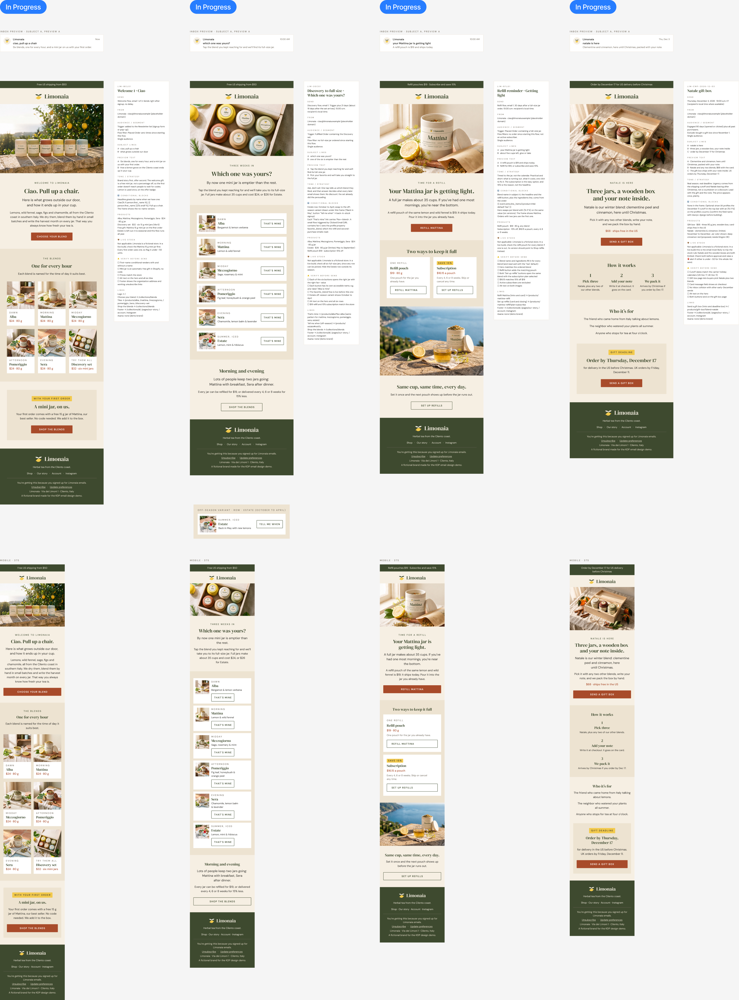

# EMAIL.md

**A design system for email that AI can follow.**

Ask an AI to design an email and you usually get something close to your brand but not quite right: colors a shade off, text that fails contrast, buttons and layouts that fall apart when someone builds the email in Klaviyo. Website designers solved part of this with design files the AI reads first. Email has its own rules, and until now it had no equivalent.

This repo is that equivalent. It covers four things:
- what to set up in Figma
- what to write down about your brand
- the skills that design an email
- the skills that check it before anyone builds it

It comes with a complete worked example: a fictional tea brand with a homepage, a brand kit and four lifecycle emails, all built and reviewed this way.

**[Download the kit (zip)](https://github.com/kingadow/email-design-md/releases/latest/download/email-design-md.zip)**, or clone the repo.

## What's inside

| | What it is | Use it to |
|---|---|---|
| [`EMAIL.md`](EMAIL.md) | A template for writing your brand down *for email*: colors and which pairs pass contrast, an email type scale, components, layout rules, photography, voice, and what each email is for | Give the AI one file to read before it designs anything |
| [`SETUP.md`](SETUP.md) | The checklist of what needs to exist in Figma before AI can design emails there | Get your file ready |
| [`skills/figma-email-readiness`](skills/figma-email-readiness) | A read-only audit that scores your Figma file out of 100 against that checklist | See exactly what is missing |
| [`skills/email-design`](skills/email-design) | The designer: turns a brief into a finished 600 px Figma email, built from your components | Design emails |
| [`skills/email-design-review`](skills/email-design-review) | The critic: a blind review that scores a finished email and lists every fix | Catch problems before the build |
| [`skills/email-remix`](skills/email-remix) | Takes an email you admire, keeps only its layout, and rebuilds it in your brand | Learn from good emails without copying them |
| [`examples/limonaia`](examples/limonaia) | The worked example, start to finish | See what good looks like |

## How it works

1. **Set up Figma.** Follow [`SETUP.md`](SETUP.md): a brand kit page, color variables, an email type scale, components, and a few conventions around each email.
2. **Write your `EMAIL.md`.** Copy the template and fill it in. It's the text version of your brand kit, the part the AI reads.
3. **Audit the file.** Run `figma-email-readiness`. Fix what it lists until the score is 90 or more.
4. **Design.** Give `email-design` a brief. It builds the email from your components, with the subject and preview above it, the mobile version beside it and a brief panel next to that.
5. **Review blind.** Run `email-design-review` as a separate agent that never saw the build. It scores the email and lists the fixes.
6. **Learn.** Any miss that shows up twice becomes a rule in your corrections log, so the next email doesn't repeat it.

Why the review has to be blind: an AI grading its own work rounds up. On a real build, self-review said 75 and a blind panel said 52.

## The example: Limonaia

Limonaia is a fictional herbal tea brand from the Cilento coast in southern Italy. It was built to show the whole process:

- **Brand.** A brand foundation doc, logo, jar labels and a labeled product photo set.
- **Website.** A brand kit page and a five-page website mockup.
- **Emails.** Four lifecycle emails: welcome, discovery set to full size, refill reminder and a holiday gift campaign.
- **First blind review.** It scored the four emails 61, 64, 63 and 64 and caught three hard failures:
  - an eyebrow color at 4.46:1 contrast
  - a price claim that was wrong for one product
  - a badge spilling out of its card
- **Fixes and rules.** Every miss was fixed. The repeated ones became rules in the [corrections log](examples/limonaia/corrections.md).
- **Second and third blind reviews.** After the first fixes, new critics scored the emails 67, 63, 63 and 69, and every one still failed a gate, mostly on photos and claims. After those fixes, the third round scored 79, 77, 74 and 79. The details are in [the example](examples/limonaia).
- **Audit.** The finished file scores 100 on the readiness audit.
- **Cold test.** A fresh Claude session, given only this repo, designed a fifth email from a brief. A blind review scored it 65 and failed it on one claim: the jar label in the photo said July 2026, and the copy promised this year's harvest for a May 2027 send. Both the builder's friction log and the review went back into these files.

Start at [`examples/limonaia`](examples/limonaia).

## What you need

- [Claude Code](https://claude.com/claude-code) or another agent that can load skills.
- The Figma MCP server with write access (`use_figma`), and Figma's own `figma-use` skill, which every Figma call here loads first.
- A Figma file for your brand.

To install the skills, copy the folders in [`skills/`](skills) into `~/.claude/skills/` (or your project's `.claude/skills/`). If you already have skills with the same names, back them up first: copying overwrites them.

## What this doesn't cover

This is the design layer. Three things sit outside it:
- **Strategy:** which emails to send, to whom, when, and why.
- **The build:** turning the design into a working email in Klaviyo.
- **Measurement:** whether the emails make money.

Those are the parts I do for brands. If you want them set up properly, you can find me at [kingadow.com](https://kingadow.com).

## License

- The templates, skills and scripts are [MIT](LICENSE).
- The Limonaia brand and images are [CC BY 4.0](LICENSE-assets.md): use them with credit.
- Limonaia is fictional, and any resemblance to a real company is a coincidence.

Made by Kinga Dow.
